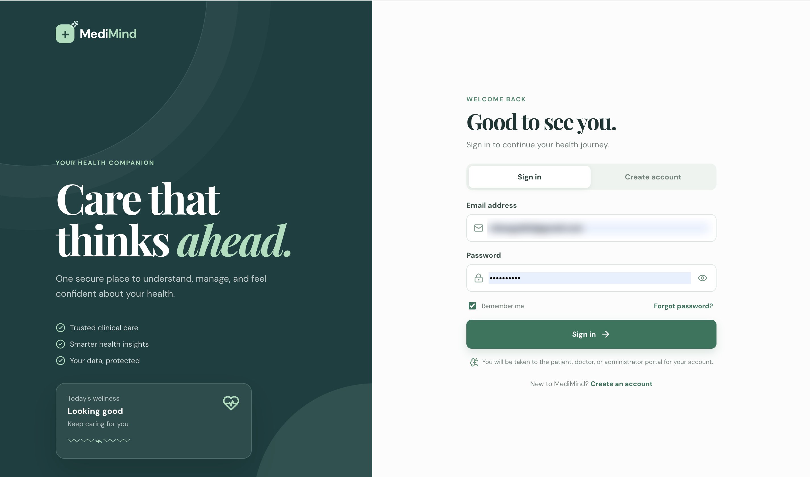
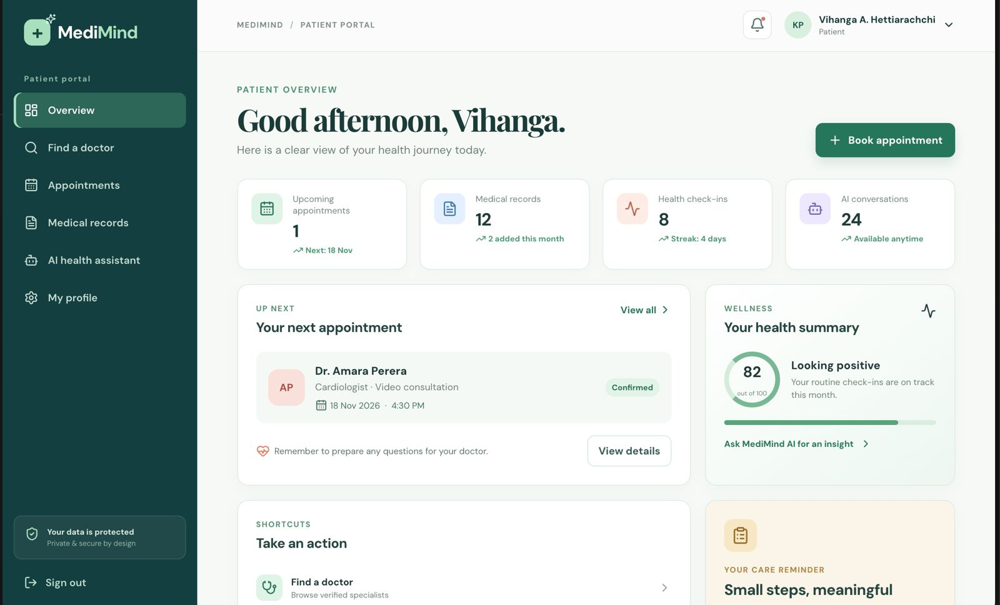

# 🩺 MediMind

**An AI-powered healthcare intelligence and patient management platform built on MongoDB, to showcase the use of NoSQL Databases for Data Science**. It demonstarted how a document database can model healthcare data, serve a full-stack web app with separate patient, doctor and administrator portals, and feed an AI service, all on a fully synthetic dataset.

> ⚠️ **Disclaimer:** As MediMind was built to run locally, the vercel deployment isn't maintained anymore. Scroll down to Getting started to use it.

---

## ✨ Features

- **Three role-based portals:** patient, doctor and administrator, each with its own protected dashboard
- **Find a doctor:** search and filter by specialty, city, availability and rating
- **Conflict-free booking:** appointments are booked in a multi-document transaction, and a unique slot index stops double booking
- **Medical records and documents:** doctors write consultation records, and patients upload PDF/JPEG/PNG files stored privately in GridFS
- **AI health assistant:** a chat assistant with emergency-phrase detection and a safe fallback answer when the AI service is down
- **No-show risk prediction:** doctors and admins can request a risk score for an appointment
- **Admin analytics:** dashboards powered by MongoDB aggregation pipelines
- **Secure by design:** JWT authentication, role-based access, bcrypt password hashing, zod validation, input sanitising and rate-limited auth endpoints

## 🖼️ Screenshots

### Log in page
One login for every role: patients, doctors and administrators are taken to their own portal after signing in.



### Patient dashboard
The patient overview shows upcoming appointments, medical records, health check-ins, AI conversations and a wellness summary, with quick links to find a doctor, book appointments and chat with the AI health assistant.



## ARCHITECTURE

| Layer | Technology |
| --- | --- |
| Frontend | React 19, Vite, React Router |
| API | Node.js 20+, Express 5, Mongoose, zod, JSON Web Tokens |
| Database | MongoDB 7+ (local replica set or MongoDB Atlas), GridFS for files |
| AI service | Python, FastAPI (internal service, called only by the Express API) |

- **Browser:** The user opens MediMind and does something, like clicking “Book appointment”.
- **React:** The frontend collects what the user entered and sends it to the Express API as an HTTP request. React only displays things and gathers input. It never touches the database.
- **Express:** The API receives the request and does the important checks:
  - Who is this user? (identity)
  - Are they allowed to do this? A patient can book their own appointment but can’t read another patient’s records. (access control)
  - Does the request follow the rules? For example, is that time slot still free? (business rules)
- **MongoDB Atlas:** Only if the checks pass does Express read from or write to the database. The result then travels back the same way: MongoDB → Express → React → the user’s screen.

## 🗄️ Database Design

The database is the core of the project and is designed around how the data is actually queried.

- **10 collections** plus GridFS file storage: `users`, `patients`, `doctors`, `appointments`, `appointment_slots`, `medical_records`, `medical_documents`, `ai_conversations`, `notifications` and `settings`
- **Embed vs reference:** small, bounded data that is always read together is embedded (a patient's allergies and emergency contact, a doctor's weekly availability, AI chat messages). Data that grows without limit is referenced (appointments, medical records, notifications)
- **`$jsonSchema` validators** enforce structure at the database level on nine collections
- **Indexes** match the main query patterns, for example `appointments { doctorId, startAt }`, `appointments { patientId, startAt }` and the unique `appointment_slots { doctorId, startAt }` that guards against double booking
- **Transactions:** booking inserts the slot reservation, the appointment and the notifications in one transaction
- **Seed data:** 500 patients, 20 doctors, 2,000 appointments and 150 AI conversations, all synthetic and reproducible

## 📊 Aggregation Pipelines

Analytics live in `backend/src/database/aggregations.js` and are served to the admin dashboard through `/api/analytics`.

| # | Pipeline | Stages | What it calculates |
| --- | --- | --- | --- |
| 1 | Appointment volume by doctor | `$group`, `$sort`, `$lookup`, `$unwind`, `$project` | Total, completed, cancelled and no-show appointments per doctor, joined to the doctor directory |
| 2 | Appointments by specialty | `$lookup`, `$unwind`, `$group`, `$project`, `$sort` | Appointment counts grouped by the doctor's specialty |
| 3 | Monthly appointments by status | `$match`, `$group`, `$project`, `$sort` | Month-by-month appointment trend split by status |
| 4 | Weekday activity | `$group` on `$dayOfWeek` | Which days of the week are busiest, in clinic time |
| 5 | Allergy prevalence | `$unwind`, `$group`, `$project`, `$sort` | The most common patient allergies from the embedded allergy arrays |
| 6 | Platform overview | `$facet` | Dashboard totals, attendance rate and trends in a single pass over appointments |

The same file also contains pipelines for doctor workload, patient growth, AI engagement and recent activity (using `$unionWith`).

## 📁 Project Structure

```text
medimind/
├── backend/            # Node.js + Express API
│   ├── src/
│   │   ├── config/       # Environment variables and MongoDB connection
│   │   ├── database/     # Validators, aggregations, seed, explain, backup, restore
│   │   ├── middleware/   # Auth, role checks, validation, sanitising, errors
│   │   ├── models/       # Mongoose models
│   │   ├── routes/       # REST endpoints grouped by resource
│   │   └── services/     # Booking rules, access rules, AI client
│   ├── tests/            # node:test + supertest API tests
│   └── openapi.yaml      # OpenAPI 3.1 specification
├── frontend/           # React + Vite application
├── docs/
│   └── screenshots/    # README images
└── .gitignore
```

## 🚀 Getting Started

### Prerequisites

- Node.js 20.12 or later and npm
- MongoDB 7+ (a single-node replica set is recommended so transactions work) or a [MongoDB Atlas](https://www.mongodb.com/atlas) cluster
- The Python FastAPI AI service (optional, see below)

### 1. Clone the repository

```bash
git clone https://github.com/vihanga2k5/medimind.git
cd medimind
```

### 2. Start the backend

```bash
cd backend
cp .env.example .env        # then set MONGODB_URI and JWT_SECRET
npm install
npm run seed -- --reset     # load the synthetic data
npm run dev
```

The API runs at `http://localhost:5000/api`.

### 3. Start the frontend

```bash
cd frontend
cp .env.example .env
npm install
npm run dev
```

Open `http://localhost:5173`.

### 4. Sign in with a demo account

After seeding, every account uses the password `MediMind123` (set by `SEED_PASSWORD`).

| Role | Email |
| --- | --- |
| Patient | `patient@medimind.test` |
| Doctor | `doctor@medimind.test` |
| Administrator | `admin@medimind.test` |

### AI service (optional)

The Express API calls an internal FastAPI service for the AI chat and no-show prediction. Set `AI_SERVICE_URL` and `AI_SERVICE_KEY` in `backend/.env`. If the service is not running, the chat returns a safe fallback answer and the rest of the app keeps working.

```text
POST {AI_SERVICE_URL}/ai/chat          { question, sessionId }  →  { answer, sources[], disclaimer }
POST {AI_SERVICE_URL}/predict/no-show  { leadTimeDays, priorMissedVisits, priorVisits, consultationType, rescheduleCount }  →  { riskScore, modelVersion }
```

## 🧰 Backend Scripts

| Command | Purpose |
| --- | --- |
| `npm run dev` / `npm start` | Start the API |
| `npm run db:setup` | Apply the `$jsonSchema` validators and build all indexes |
| `npm run seed -- --reset` | Drop and reseed the database with synthetic data |
| `npm run aggregations` | Run every analytics pipeline and compare it with control totals |
| `npm run explain` | Capture `explain("executionStats")` before and after the compound index |
| `npm run backup` / `npm run restore` | Export and restore every collection |
| `npm test` | Run the API tests against an in-memory MongoDB replica set |

The full API contract is in [`backend/openapi.yaml`](backend/openapi.yaml).

## 👥 Team

| Name | GitHub |
| --- | --- |
| Vihanga | [@vihanga2k5](https://github.com/vihanga2k5) |

## 📄 License

This project was created for academic purposes.
